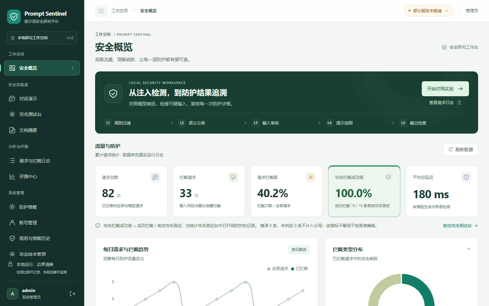

# 前端界面优化记录（2026-10-28）

本轮先运行原有界面并截图，再调整公共外观及常用交互。使用隔离数据库和测试记录检查页面；本文截图中的数量、比例、延迟和回复均为界面测试数据，不构成模型效果或性能实验。

## 检查发现与完成的改进

| 范围 | 原有使用问题 | 完成的改进 |
| --- | --- | --- |
| 导航与页面结构 | 侧栏功能较多，多类管理入口集中在一起；不能收起 | 分为工作空间、安全实验室、分析与评测、系统管理；深青侧栏区分浅色内容区，可收起至图标并记住本机偏好，图标保留名称提示 |
| 首页 | 指标、说明和操作入口的视觉区分不足 | 首页展示五层防护架构，突出对照实验和日志入口；单独强调已有攻击拦截成功率及有效样本分母，保持全部统计口径 |
| 公共样式 | 辅助文字偏小、部分颜色偏淡，各页面组件细节不一致 | 统一标题、卡片、按钮、表单、表格、空状态、图表字体和登录页主色，使用本机字体，不新增外部字体下载 |
| 手机导航 | 打开后仍可将键盘焦点移到背景，缺少明确关闭入口 | 增加关闭按钮、Escape关闭、焦点循环、背景不可交互和滚动锁；关闭后恢复滚动并返回菜单按钮，切换到桌面宽度时自动退出抽屉 |
| 长表格 | 手机上只有部分列可见，用户不易发现表格还能横向移动 | 为10处表格引入共享TableScroll组件，仅在内容超宽时显示提示；滚动区可聚焦并用左右方向键滚动，不拉宽整页 |
| 回复与文件 | 回复缺少复制入口，已选文件没有独立移除操作 | 可复制模型回复或拦截说明；权限受限时提示手动复制。可移除文件并再次选择同一个文件，清理旧结果 |
| 普通用户 | 个人密码入口仍显示管理员口吻 | 普通用户显示“个人设置 / 个人账号”，页面和浏览器标题一致，管理员专属入口继续隐藏 |

五层流程图表示架构，不表示每层已加载或已启用。顶部服务状态继续来自后端检查；本轮未启动目标模型服务，截图如实显示“部分服务未就绪”。

## 验证

- 13个页面完成桌面视图检查；12个登录后页面完成390px手机截图，登录页另行检查手机显示。
- 安全概览、对话、评测、运行维护覆盖360、390、768、820、1024、1280、1440七种宽度，共28组检查，没有整页横向溢出。
- 侧栏收起及刷新保持、图表自动适配、跳过导航、手机菜单焦点与Escape、背景滚动恢复、表格键盘滚动、复制成功与拒绝权限提示、文件移除与重选、普通用户入口和空数据状态通过浏览器检查。
- 抽查8处常用文字，计算对比度均不低于4.5:1；这不是完整无障碍合规认证。
- 前端生产构建、改动文件Prettier检查和Git空白检查通过。343项回归测试通过、1项集成测试排除；已有Starlette弃用提示及较大组件包提示仍保留。
- 3193个既有论文、结果、原始模型及数据库文件的SHA-256保持一致。开题报告已有的本地修改保留，不纳入本次提交。

本轮修改前端与说明文档，未重做模型推理或ASR实验。前一轮真实模型抽查仍见[项目优化记录](OPTIMIZATION_REPORT_20261028.md)。验证完成后关闭本轮创建的后台服务。

## 预览与证据

以下截图均使用隔离的界面测试数据。

更多截图见[手机菜单](../results/ui_refinement_20261028/mobile-navigation.png)、[手机表格](../results/ui_refinement_20261028/mobile-table-scroll.png)、[收起导航](../results/ui_refinement_20261028/sidebar-collapsed.png)、[手机登录页](../results/ui_refinement_20261028/login-mobile.png)。[验证摘要](../results/ui_refinement_20261028/summary.json)记录检查范围和源文件指纹。

公共外观优先在`frontend/src/console.css`维护；页面原有布局位于`styles.css`。导航交互在`components/Layout.vue`，回复操作在`components/PipelineResult.vue`，表格提示在`components/TableScroll.vue`。
